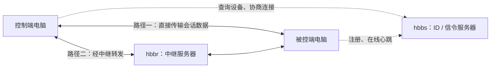
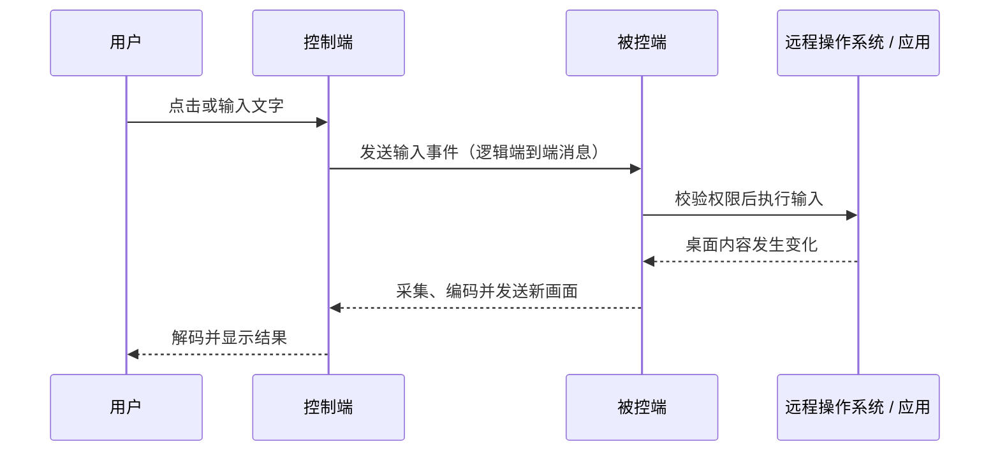

# CodoRustDesk 远程控制方案的技术原理

本文结合 RustDesk 的架构和 CodoRustDesk 的本地实现，说明设备发现、连接建立、画面传输、输入控制、认证加密及办公优化之间的关系。

代码基线：[`44d2c2451`](https://github.com/zhanwang-dandan/CodoRustDesk/commit/44d2c24518b59b50da80891beec303befd58b4d8)，包含主线构建流程与 `codo-trusted-controllers` 功能。说明以 Windows 原生 Flutter 客户端为主，不代表某次实际会话已经采用某种线路或编码。

## 1. 远程操作如何发生

远程电脑持续把桌面画面传给控制端；控制端把鼠标、键盘等输入事件送回去，由远程电脑执行。执行结果改变桌面，再通过下一批画面反馈给用户。

例如，在国内操作一台美国电脑时，浏览器、办公软件和文件处理都运行在美国电脑上。远程浏览器访问网站时，使用那台电脑自身的网络出口。控制端主要负责显示画面和发送操作。

## 2. 系统由哪些部分组成

| 组成 | 职责 |
| --- | --- |
| 控制端客户端 | 查找设备、发起连接、解码显示画面、采集本地输入 |
| 被控端客户端及系统服务 | 验证访问权限、采集编码桌面、执行输入、提供会话服务 |
| `hbbs`：ID / 信令服务器 | 维护设备在线信息，协助两端交换连接信息、尝试直连 |
| `hbbr`：中继服务器 | 在直连不可用或配置要求中继时，转发两端的会话数据 |
| 账户 / API 服务（可选） | 提供账户登录、地址簿及部署所支持的设备管理功能 |

图中两条数据路径表示不同选择。`hbbs` 协助建立连接；成功直连后，画面流可以直接在两台电脑之间传输。账户登录与对某台电脑的远程访问授权，属于不同环节。

两端需要使用能够互相发现设备的 ID / 信令基础设施。具体使用公共服务还是自建服务，应查看客户端配置，不能仅凭软件名称判断。

## 3. 从输入设备 ID 到建立连接

1. **登记在线信息。** 客户端启动后向 ID 服务器注册，并通过周期性消息更新在线状态和网络可达信息。
2. **查询目标设备。** 控制端提交对方 ID，服务器定位对应设备并协助交换连接信息。设备 ID 用于定位，访问权限由后续认证判断。
3. **尝试直接连接。** 两端通常位于 NAT 路由器或防火墙后面。服务器协调双方尝试建立连接，这一过程通常称为“打洞”。能否成功取决于两端网络、地址映射规则和相关配置。
4. **必要时使用中继。** 直连失败或被配置为使用中继时，两端连接 `hbbr`，由它转发会话数据。
5. **完成会话握手与访问认证。** 两端进行身份及加密相关协商，被控端根据密码、人工接受、受支持的信任凭证及访问策略等条件决定是否授权。

项目包含 TCP、UDP 打洞、IPv6 和 WebRTC 等相关实现路径。实际采用的传输方式由版本、构建能力、配置和网络条件共同决定，不能把所有会话都固定理解成某一种协议。

| 方式 | 数据路径 | 性能与成本特点 |
| --- | --- | --- |
| 直连 | 控制端 ↔ 被控端 | 画面流不经过中继服务器，中继流量成本较低 |
| 中继 | 控制端 ↔ 中继 ↔ 被控端 | 需要考虑中继的地理位置、带宽、负载和两段线路质量 |

直连的实际速度仍取决于网络质量；一条质量较好的中继线路，也可能优于质量较差的直连线路。

默认的服务端核心端口包括 TCP `21115`（NAT 类型测试）、TCP / UDP `21116`（注册及连接协商相关功能）、TCP `21117`（中继）。账户 API 和 WebSocket 等功能另有端口与部署要求。端口可以配置，详细规则参见[官方自建服务说明](https://rustdesk.com/docs/en/self-host/)。

## 4. 画面如何传过来

基本处理链路为：

> 被控端采集屏幕 → 视频编码压缩 → 加密与传输 → 控制端解密、解码 → 绘制到窗口。

Windows 采集代码包含 DXGI 桌面采集及兼容性路径。视频编码模块支持 VP8、VP9、AV1，以及在相应构建和设备能力下可用的 H.264、H.265 等格式。实际格式由两端协商，硬件编码也取决于 GPU、驱动及构建选项。

压缩的原因是原始像素数据量很大。例如，1920 × 1080、每像素 4 字节、每秒 30 帧，未压缩的理论数据量约为 **249 MB/s，即约 2 Gbit/s**。这只是像素数据的估算，不包含协议开销，也不代表实际会话码率。

编码后的实际流量受画面变化、分辨率、画质、帧率、编码格式等因素影响。持续滚动页面、播放视频，通常比停留在静态文档上需要更多数据。静态桌面的画面更新帧率较低，可以是正常行为。

## 5. 鼠标、键盘和其他数据如何处理

当用户点击按钮时，控制端会把坐标、鼠标按键、按下或松开等信息编码为事件消息。被控端在权限允许的情况下处理这些消息，并通过系统输入接口执行操作。Windows 输入库中包含 `SendInput` 调用。

图中的控制端与被控端消息，也可以通过中继转发。窗口缩放、多显示器及屏幕分辨率不同，都需要在输入处理中考虑坐标映射。

剪贴板、音频和文件传输有各自的消息与处理模块。例如，复制文字通过剪贴板同步处理，文件传输通过文件读写消息处理；这些数据都需要结合相应的会话权限。

## 6. 认证与加密分别解决什么问题

**访问认证决定谁可以操作。** 被控端依据所配置的认证方式和权限策略接受或拒绝连接。登录账户、知道设备 ID、获得某台电脑的控制权限，是不同的状态。

**加密保护传输中的会话数据。** 原生客户端的连接握手代码会处理签名身份信息、密钥协商和会话加密。TCP 流实现包含基于 `secretbox` 的数据加解密；WebRTC 路径包含 DTLS 及设备身份绑定相关处理。

成功建立端到端加密会话后，中继转发的是密文。中继仍能观察连接时间、连接来源、流量大小等元信息。

当前代码保留了部分兼容性的非安全连接路径，因此“连接成功”不能单独证明身份校验和端到端加密已经完成。应结合客户端安全状态及握手结果判断。相关实现可从 [`Client::secure_connection`](https://github.com/zhanwang-dandan/CodoRustDesk/blob/44d2c24518b59b50da80891beec303befd58b4d8/src/client.rs#L1655) 阅读。

自建服务配置中的 `Key` 是服务器公钥，参与相关加密及身份信任配置；它与远程访问密码、账户密码各有用途，具体配置参见[官方客户端配置说明](https://rustdesk.com/docs/en/self-host/client-configuration/)。

## 7. CodoRustDesk 新增的功能

### 7.1 由被控端批准的免密信任

该分支新增独立的 Codo 信任凭证路径，典型流程如下：

1. 控制端选择记住密码时，为目标主机创建或复用一个随机凭证。
2. 首次访问仍通过被控端原有的授权流程。
3. 被控端用户在连接窗口明确选择“信任此设备”。
4. 后续连接携带已批准的凭证，由被控端验证后进入授权流程。
5. 被控端可以在“设置 → 安全 → 免密信任设备”撤销单台设备或全部设备的信任。

当前实现的关键约束：

- 凭证长度为 32 字节；被控端保存其 SHA-256 摘要及设备说明信息。
- 控制端保存可用于再次认证的凭证，应按访问凭证的等级保护，避免放入日志、诊断或版本库。
- 专用认证入口要求会话流已经处于加密状态，并限制为相应的远程控制连接。
- 信任由独立凭证表示，修改远程访问密码不会自动撤销这项信任。
- 撤销会影响后续的信任认证；当前实现没有在撤销配置时主动断开已经授权的会话。
- 两端均需要支持这项扩展。仅升级其中一端，无法完成整个信任流程。

凭证处理见 [src/codo_trust.rs](../src/codo_trust.rs)，会话接入条件见 [src/server/connection/codo_trust.rs](../src/server/connection/codo_trust.rs)。

### 7.2 办公画质预设

| 预设 | 画质参数 | 帧率上限 | 主要用途 |
| --- | --- | --- | --- |
| 均衡办公 | 60 | 30 FPS | 浏览器、邮件、日常操作 |
| 文字与代码 | 80 | 20 FPS | 优先文字边缘清晰度，并请求 4:4:4 真彩色 |
| 低带宽办公 | 40 | 15 FPS | 减少画面数据，便于比较拥挤线路下的表现 |
| 流畅操作 | 45 | 30 FPS | 降低画质、保留帧率上限，减轻画面排队压力 |

这些参数是配置值，实际帧率和吞吐量由会话动态决定。当前预设的 4:4:4 真彩色功能受远端版本和 AV1 / VP9 编码条件约束；自定义帧率也会遵循公共中继及版本相关的限制。

诊断面板提供连接方式、延迟、帧率、传输速度、目标码率、编码及色度等指标。面板还提供本机 UDP 打洞和 IPv6 直连的配置入口；能否实际直连仍取决于两端配置和网络。

## 8. 延迟、清晰度和黑边之间的关系

可见的操作响应时间，可以近似拆解为：

> 输入事件传到远端的时间 + 远端处理及等待下一帧的时间 + 采集与编码时间 + 画面传回的时间 + 本地解码与显示时间。

跨国网络的往返延迟、远端上传带宽、中继线路、编码性能、丢包和队列积压，都可能影响体验。降低画质主要减轻数据量及编码压力；实际收益需要结合指标和操作体验比较。

画面周围的黑边还与显示方式有关：

| 显示方式 | 作用与取舍 |
| --- | --- |
| 原始尺寸 | 按远程画面的原始尺寸显示，较大的本地窗口可能留下明显空白 |
| 适应窗口 | 按比例缩放画面，减少空白；宽高比不一致时仍可能保留黑边 |
| 提高远程分辨率 | 可以增加实际桌面空间和画面细节，也可能增加采集、编码及传输负担 |

全屏会改变可用显示区域；本地放大显示不会凭空增加远程图像的细节。

## 9. 代码阅读入口

| 功能 | 主要位置 |
| --- | --- |
| Flutter 桌面界面 | [flutter/lib/desktop](../flutter/lib/desktop) |
| Flutter 与 Rust 的桥接接口 | [src/flutter_ffi.rs](../src/flutter_ffi.rs)、[src/flutter.rs](../src/flutter.rs) |
| ID 注册、连接协商、打洞与中继请求处理 | [src/rendezvous_mediator.rs](../src/rendezvous_mediator.rs) |
| 控制端连接、握手、登录与媒体处理 | [src/client.rs](../src/client.rs)、[src/client/io_loop.rs](../src/client/io_loop.rs) |
| 被控端授权及会话消息处理 | [src/server/connection.rs](../src/server/connection.rs) |
| 屏幕采集与视频编码调度 | [src/server/video_service.rs](../src/server/video_service.rs)、[libs/scrap](../libs/scrap) |
| 鼠标键盘事件处理与系统输入 | [src/server/input_service.rs](../src/server/input_service.rs)、[libs/enigo](../libs/enigo) |
| 会话消息结构 | [libs/base/protos/message.proto](../libs/base/protos/message.proto) |
| 剪贴板与文件读写 | [libs/clipboard](../libs/clipboard)、[libs/base/src/fs.rs](../libs/base/src/fs.rs) |
| Codo 免密信任及管理界面 | [src/codo_trust.rs](../src/codo_trust.rs)、[flutter/lib/desktop/widgets/codo_trust.dart](../flutter/lib/desktop/widgets/codo_trust.dart) |
| 办公预设与诊断面板 | [flutter/lib/utils/office_profile.dart](../flutter/lib/utils/office_profile.dart)、[office_session_panel.dart](../flutter/lib/desktop/widgets/office_session_panel.dart) |

`libs/hbb_common` 是共享子模块，包含网络、配置和流加密等基础能力；客户端专用的选项及协议结构还分布在 `libs/base`。服务端 `hbbs` / `hbbr` 的实现由独立的 [rustdesk-server 仓库](https://github.com/rustdesk/rustdesk-server) 提供。

## 10. 参考资料

- [RustDesk 官方：自建服务与连接原理](https://rustdesk.com/docs/en/self-host/)
- [RustDesk 官方：客户端配置、Key 与 API Server](https://rustdesk.com/docs/en/self-host/client-configuration/)
- [CodoRustDesk：本文代码基线](https://github.com/zhanwang-dandan/CodoRustDesk/tree/44d2c24518b59b50da80891beec303befd58b4d8)
- [CodoRustDesk：Windows 构建与打包说明](../scripts/windows/README.md)
